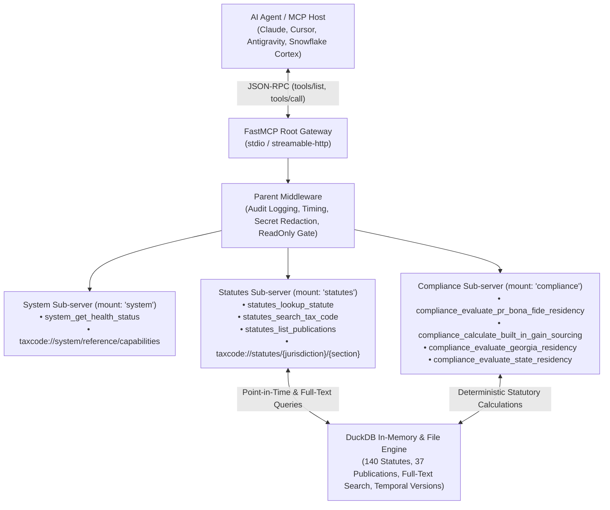

<!-- mcp-name: io.github.christianclaudio/taxcode -->

# 📦 mcp-server-taxcode

[](https://github.com/christianclaudio/mcp-server-taxcode/actions/workflows/ci.yml)
[](https://opensource.org/licenses/Apache-2.0)
[](https://github.com/christianclaudio/mcp-server-taxcode)
[](https://coderabbit.ai)

> **Enterprise-grade Model Context Protocol (MCP) server for Federal, Territorial, and Multi-State Tax Law.**  
> Reference statutory catalog covering United States Federal (IRC/CFR), Puerto Rico (Act 60/Ley 1), and all 50 US States + District of Columbia with computational residency and capital gains models.

> [!WARNING]
> **NOT TAX OR LEGAL ADVICE / NO CONSTITUYE ASESORAMIENTO CONTRIBUTIVO NI LEGAL**  
> **EN:** This software and its tools provide computational models, heuristic checks, and unofficial summaries for informational and research purposes only. Nothing returned by this server constitutes formal legal or tax advice, an official legal opinion, or audit representation. Unofficial translations and summaries are non-binding; official statutory and administrative sources in their enacted language control.  
> **ES:** Este software y sus herramientas proporcionan modelos computacionales, verificaciones heurísticas y resúmenes no oficiales únicamente para fines informativos y de investigación. Ninguna respuesta emitida por este servidor constituye asesoramiento legal o contributivo formal, una opinión legal oficial ni representación ante auditorías. Las traducciones y resúmenes no oficiales no son vinculantes; los textos estatutarios y administrativos oficiales promulgados en su idioma original prevalecen.

---

## 🏗️ Architecture: FastMCP 4 Server Composition



---

## 🚀 Key Features

* **Authoritative Multi-Jurisdiction Statutory Catalog**:
  * **Federal (`US`)**: IRC § 1, § 24, § 32, § 61, § 62, § 63, § 865, § 911, § 933, § 937, § 957, § 1411, § 6012, § 6688, 26 CFR § 1.937-1/2/3, and IRS publications (Pub. 17, Pub. 54, Pub. 501, Pub. 505, Pub. 570, Pub. 1321).
  * **Puerto Rico (`PR`)**: Act 60-2019 (Resident Individual Investors, Export Services & Opportunity Zone definitions, Sec. 6020.10 annual reports), Ley 1-2011 (including Sec. 1031.02 exemptions and Sec. 1062.01 wage withholding and Sec. 1062.03 withholding on payments for services), Act 22-2012 predecessor versions, and administrative publications (CC RI 21-10, CC RI 25-12, CC RI 26-13, DA 21-04, DA 23-04, BI RI 26-02).
  * **All 50 US States + District of Columbia**: Comprehensive statutory definitions and tax computations covering no-income-tax states (AK, FL, NV, NH, SD, TN, TX, WA, WY), flat-tax regimes (AZ, CO, GA, ID, IL, IN, IA, KS, KY, MI, MS, NC, PA, UT), and graduated/surtax jurisdictions (AL, AR, CA, CT, DE, DC, HI, LA, ME, MD, MA, MN, MO, MT, NE, NJ, NM, NY, ND, OH, OK, OR, RI, SC, VT, VA, WV, WI) including Convenience of the Employer rules (NY, PA, NJ, CT, DE, NE) and local piggyback taxes (MD, IN, OH, NY).
* **Snippet Search, Full Text by Id**: `statutes_search_tax_code` matches and ranks on the full text but returns a short snippet (up to 300 characters around the first matched term) plus each result's `id`, citation, title, jurisdiction, year, validity and content labels. Pass an `id` to `statutes_lookup_statute` as `citation_or_section` for the full text.
* **Bounded Responses with Paging**: Every statutes tool result stays under 32,000 characters of JSON. `statutes_lookup_statute` returns long text in pages of up to 8,000 characters per text field (`text_page` gives the offset and full lengths; pass `next_cursor` back as `page_cursor` for the next page). `statutes_search_tax_code` and `statutes_list_publications` clamp `limit` to 1..25 items per call, with `offset` and `next_offset` for the next page. The `taxcode://statutes/{jurisdiction}/{section}` resource (for example `taxcode://statutes/US/933`) uses the same 8,000-character pages and cap: a page that is not the last ends with the URI of the next one, which carries a `?page_cursor=` query.
* **Versioned Data Files**: Every statute and publication row lives in per-jurisdiction JSON under `src/taxcode_mcp/data/` with a source record per row, and the docs under `docs/` are generated from them (see [`CONTRIBUTING.md`](CONTRIBUTING.md)).
* **Temporal Statutory Versioning**: Point-in-time statutory lookup with `superseded_year` filtering and descending historical ordering (`tax_year` parameter).
* **Deterministic Compliance Engines**:
  * `evaluate_pr_bona_fide_residency`: Evaluates IRC § 937 presence (183-day, 549-day 3-year, 90-day US), tax home, and closer connection tests.
  * `calculate_built_in_gain_sourcing`: Allocates Section 937 / Act 60 capital gains across pre-move and post-move holding periods.
  * `evaluate_state_residency`: Multi-state statutory presence day-counter, permanent place of abode (PPA), domicile audit risk flags, and tax liability computation across all 50 US states and District of Columbia (51 jurisdictions total).
* **Profiles & Opt-in ToolSearch**:
  * Domain-mount profiles: `full`, `system`, `statutes`, `compliance`, `readonly`.
  * Job-shaped allowlist profiles: `researcher` (statutes + circulars), `advisor` (cross-border residency + BIG calculations).
* **Zero Tool Bloat**: Exactly 8 lean, read-only MCP tools exposed with explicit MCP 2.0 annotations (`readOnlyHint=True`).

---

## ⚙️ Configuration

| Variable | CLI Flag | Default | Description |
| :--- | :--- | :--- | :--- |
| `TAXCODE_API_KEY` | — | `""` | Service API token for authentication |
| `TAXCODE_BASE_URL` | — | `https://api.example.com` | Upstream REST API base URL |
| `TAXCODE_MCP_READONLY` | — | `0` | Restrict server execution strictly to safe read-only inspection tools |
| `TAXCODE_MCP_PROFILE` | `--profile` | `full` | Server profile: `full`, `system`, `statutes`, `compliance`, `readonly`, `researcher`, `advisor` |
| `TAXCODE_MCP_ENABLE_TOOL_SEARCH` | `--enable-tool-search` | `0` | Replace flat catalog with dynamic search meta-tools (`profile=full` only) |
| `TAXCODE_MCP_ENABLE_CODE_MODE` | `--enable-code-mode` | `0` | Experimental Code Mode on `full` (requires `code-mode` extra) |
| `TAXCODE_MCP_AUTH_TOKEN` | — | `""` | Shared bearer token for HTTP transports (`streamable-http`, `sse`) |
| `TAXCODE_MCP_ALLOW_UNAUTHENTICATED_BIND` | — | `0` | Set to `1` (or `true`/`yes`/`on`) to let an HTTP transport bind a host other than `127.0.0.1`, `::1` or `localhost` with no token. Without it, such a bind exits at startup |

### HTTP transports and authentication

Stdio is the default and needs no token. The HTTP transports follow the MCP guidance that a local server binds only to localhost and authenticates every connection:

* On `127.0.0.1`, `::1` or `localhost` (the `--host` default is `127.0.0.1`), HTTP runs with or without `TAXCODE_MCP_AUTH_TOKEN`; without it, a warning says requests are not authenticated.
* On any other host (`0.0.0.0`, `::`, a LAN address), the server refuses to start unless `TAXCODE_MCP_AUTH_TOKEN` is set, or `TAXCODE_MCP_ALLOW_UNAUTHENTICATED_BIND=1` accepts an unauthenticated bind (logged as a warning), for example behind a gateway that authenticates for you.
* With a token set, every HTTP request needs `Authorization: Bearer <token>`; a missing or wrong token gets HTTP 401.
* In the default (stateful) HTTP mode, a session idle for 30 minutes expires: its next request gets HTTP 404 and the client must start a new session. Change this with FastMCP's `session_idle_timeout` (on `http_app()`) or `FASTMCP_HTTP_SESSION_IDLE_TIMEOUT` (seconds, or `none` to never expire); see the [FastMCP 4.1.0 release](https://github.com/PrefectHQ/fastmcp/releases/tag/v4.1.0) and [#5229](https://github.com/PrefectHQ/fastmcp/pull/5229).

```bash
# Local HTTP, loopback only
taxcode-mcp --transport streamable-http

# Public HTTP with a token
TAXCODE_MCP_AUTH_TOKEN="$(openssl rand -hex 32)" \
  taxcode-mcp --transport streamable-http --host 0.0.0.0 --allowed-host mcp.example.com
```

### Docker

The image's default command is stdio, so it works as a stdio server out of the box:

```bash
docker run -i --rm -e TAXCODE_API_KEY=your-api-key ghcr.io/christianclaudio/mcp-server-taxcode:latest
```

To serve Streamable HTTP from the container, bind `0.0.0.0` inside it and pass a token:

```bash
docker run --rm -p 8000:8000 \
  -e TAXCODE_API_KEY=your-api-key \
  -e TAXCODE_MCP_AUTH_TOKEN=your-long-random-token \
  ghcr.io/christianclaudio/mcp-server-taxcode:latest \
  --transport streamable-http --host 0.0.0.0 --port 8000 --allowed-host mcp.example.com
```


---

## 🔌 Integration Guides for AI Assistants & IDEs

This server works out-of-the-box with all major AI assistants, IDEs, and CLI tools via standard `stdio` or `streamable-http`.

The server is published on PyPI as [`mcp-server-taxcode`](https://pypi.org/project/mcp-server-taxcode/), so you can run it directly with `uvx mcp-server-taxcode` without cloning or manually managing environments. Alternatively, run from a local clone with `uv run --directory /path/to/mcp-server-taxcode taxcode-mcp`.

<details open>
<summary><b>🧡 Claude Desktop & Claude Code</b></summary>

Add to `~/Library/Application Support/Claude/claude_desktop_config.json` (macOS) or `%APPDATA%\Claude\claude_desktop_config.json` (Windows):

```json
{
  "mcpServers": {
    "taxcode": {
      "command": "uvx",
      "args": ["mcp-server-taxcode"]
    }
  }
}
```

For local development from a clone:
```json
{
  "mcpServers": {
    "taxcode": {
      "command": "uv",
      "args": ["run", "--directory", "/absolute/path/to/mcp-server-taxcode", "taxcode-mcp"]
    }
  }
}
```

For **Claude Code CLI**:
```bash
claude mcp add taxcode -- uvx mcp-server-taxcode
```
</details>

<details>
<summary><b>♊ Google Antigravity & Gemini CLI</b></summary>

Add to `.agents/mcp_config.json` (or global `~/.gemini/config/mcp_config.json`):

```json
{
  "mcpServers": {
    "taxcode": {
      "command": "uvx",
      "args": ["mcp-server-taxcode"]
    }
  }
}
```
</details>

<details>
<summary><b>❄️ Snowflake Cortex Agent</b></summary>

Add to `~/.snowflake/cortex/mcp.json`:

```json
{
  "mcpServers": {
    "taxcode": {
      "command": "uvx",
      "args": ["mcp-server-taxcode"]
    }
  }
}
```
</details>

<details>
<summary><b>💻 Cursor & Windsurf</b></summary>

Add to `~/.cursor/mcp.json`:

```json
{
  "mcpServers": {
    "taxcode": {
      "command": "uvx",
      "args": ["mcp-server-taxcode"]
    }
  }
}
```
</details>

<details>
<summary><b>⚡ VS Code (Cline, Roo Code, GitHub Copilot Agent Mode)</b></summary>

Add to `cline_mcp_settings.json`:

```json
{
  "mcpServers": {
    "taxcode": {
      "command": "uvx",
      "args": ["mcp-server-taxcode"]
    }
  }
}
```
</details>

---

## 📚 Canonical Documentation & Live Doc MCPs

When developing, hardening, or extending MCP servers, consult the official framework and protocol references:

* **FastMCP 4 Framework Reference**: [`https://gofastmcp.com/llms.txt`](https://gofastmcp.com/llms.txt) — Server composition (`mount`), hierarchical middleware, transforms (`ToolTransform`, `ToolSearch`), lifespans, and in-memory test clients.
* **Model Context Protocol Specification**: [`https://modelcontextprotocol.io/llms.txt`](https://modelcontextprotocol.io/llms.txt) — Official Spec (2026-07-28), wire-level JSON-RPC schemas, annotations, and transport framing.

### Live Documentation MCP Endpoints (SSE / Streamable HTTP)
Connect your AI coding agent directly to live documentation servers:
* **FastMCP Documentation Server**: `https://gofastmcp.com/mcp` (Tools: `search_fast_mcp`, `query_docs_filesystem_fast_mcp`, `submit_feedback`)
* **Anthropic MCP Documentation Server**: `https://modelcontextprotocol.io/mcp` (Tools: `search_model_context_protocol`, `query_docs_filesystem_model_context_protocol`, `submit_feedback`)

```json
{
  "mcpServers": {
    "fastmcp-docs": { "type": "sse", "url": "https://gofastmcp.com/mcp" },
    "mcp-official-docs": { "type": "sse", "url": "https://modelcontextprotocol.io/mcp" }
  }
}
```

---

## 🏃 Local Development & Verification

```bash
# 1. Install dependencies from the lockfile
uv sync --locked --extra dev

# 2. Run unit tests with 100% coverage requirement
uv run pytest

# 3. Static type checks & linting
uv run mypy --strict src/
uv run ruff check .
uv run ruff format --check .

# 4. Tool contract, protocol & drift assertions
uv run python scripts/check_tool_contract.py
uv run python scripts/check_openapi_drift.py
uv run python scripts/build_catalog.py --check   # data files, source manifest, generated docs
uv run pytest tests/test_protocol.py
uv run pytest tests/test_e2e_live.py -m e2e   # on demand; default CI uses -m 'not e2e'
./scripts/check_conformance.sh

# 5. AI code review gate (CodeRabbit)
coderabbit review --agent --uncommitted
```

---

## 📄 License

Licensed under the **Apache License 2.0**. See [`LICENSE`](LICENSE) for details.
