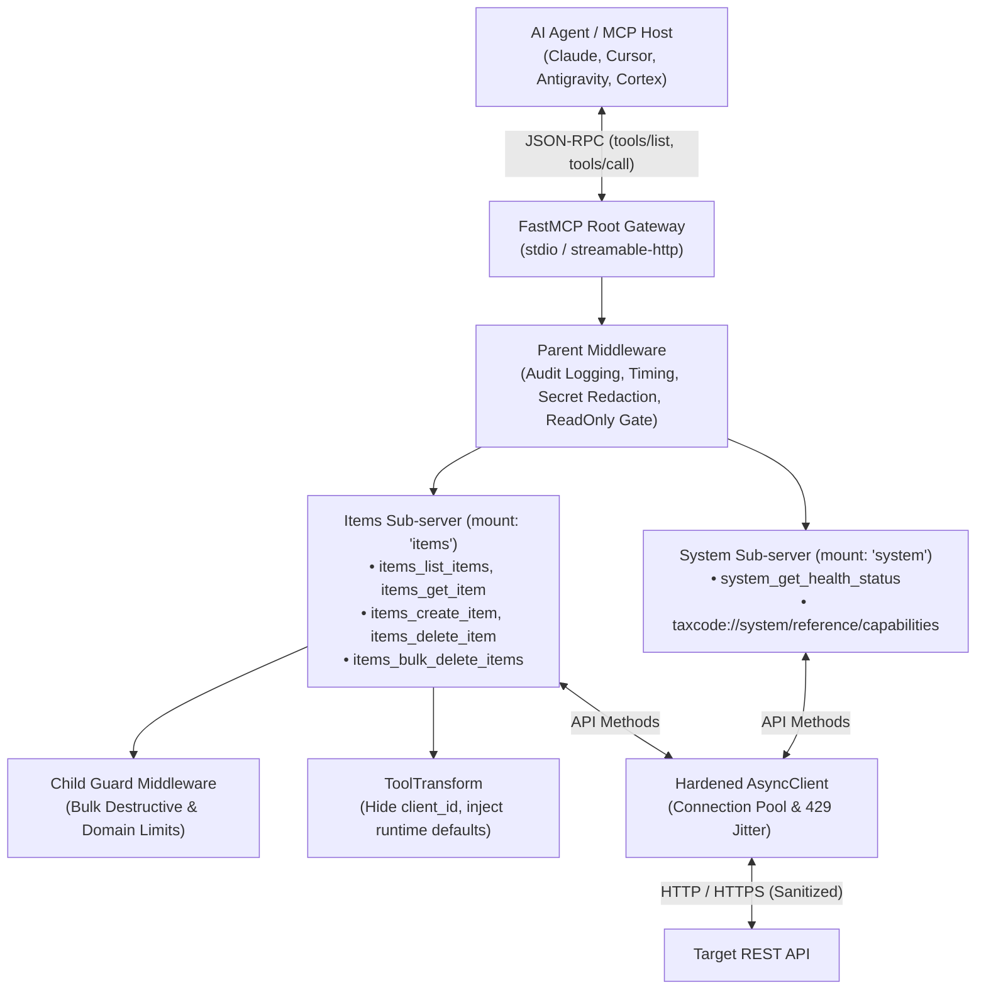

<!-- mcp-name: io.github.christianclaudio/taxcode -->

# 📦 mcp-server-taxcode

[](https://github.com/christianclaudio/mcp-server-taxcode/actions/workflows/ci.yml)
[](https://opensource.org/licenses/Apache-2.0)
[](https://github.com/christianclaudio/mcp-server-taxcode)
[](https://coderabbit.ai)

> **Enterprise-grade Model Context Protocol (MCP) server template.**  
> Provides a hardened, production-ready blueprint with static typing (`mypy --strict`), 100% statement coverage, single-delete & bulk safety gates, and automated multi-channel OIDC release workflows.

---

## 🏗️ Architecture: FastMCP 4 Server Composition



---

## 🚀 Key Features

* **FastMCP 4 Server Composition**: Modular sub-servers mounted via `root.mount(..., namespace="...")` providing clean domain boundaries and automatic namespacing (`system_*`, `items_*`).
* **Hierarchical Middleware Pipeline**: Global parent middleware for audit logging and read-only gating; child middleware for domain safety gates (bulk destructive controls).
* **Tool Transformation**: `ToolTransform` hides internal infrastructure arguments (`client_id`) from LLM schemas and injects defaults automatically at runtime.
* **Profiles & Opt-in ToolSearch**:
  * Run focused surfaces using `--profile`: domain-mount profiles `full|system|items|readonly`, or job-shaped tool-name allowlist profiles that span domains (`intake`). Unknown profiles or allowlisted names fail at startup.
  * Read-only (`--profile readonly` or `TAXCODE_MCP_READONLY=1`) is decided by each tool's `readOnlyHint` annotation; any other tool is refused, including through `call_tool` when Tool Search is on; an unknown name (including `call_tool` without Tool Search) still returns `Unknown tool`.
  * Preserves standard flat `tools/list` by default for seamless IDE and host compatibility.
  * Opt-in `--enable-tool-search` replaces flat lists with dynamic `search_tools` and `call_tool`.
  * Experimental, opt-in `--enable-code-mode` (`full` only; not with Tool Search) replaces flat lists with `search`, `get_schema` and `execute`. Code Mode needs the package's `code-mode` extra, which pulls `fastmcp[code-mode]` (the `pydantic-monty` sandbox): install `mcp-server-taxcode[code-mode]`, or from a clone run `uv sync --extra code-mode`. Without it, Code Mode is skipped with a warning and the flat catalog is served. Code Mode is optional: FastMCP ships its sandbox as an extra ([FastMCP Code Mode docs](https://gofastmcp.com/servers/transforms/code-mode)). Any doc or post that quotes a Code Mode token figure must say it needs the `code-mode` extra.
* **MCP 2.0 Annotations**: Every tool declares explicit `readOnlyHint`, `destructiveHint`, `idempotentHint`, and `openWorldHint` flags.
* **Safety by Default**:
  * Mandatory `confirm: bool = False` confirmation gate on single-record deletions.
  * Bulk destructive operations gated behind `TAXCODE_MCP_ALLOW_BULK_DESTRUCTIVE=1` and `dry_run=True` defaults.
  * Global `TAXCODE_MCP_READONLY=1` runtime toggle restricting startup strictly to safe query tools.
* **Secret Redaction**: Automated regex scrubbing (`redact_secrets`) for Bearer tokens, API keys, client secrets, passwords, and access tokens in error messages and logs, with a fixed `[REDACTED]` mask that never reveals a secret's length.
* **Path Traversal Protection**: Parametric path sanitization (`urllib.parse.quote(seg, safe="")`).
* **Multi-Channel Distribution**:
  * **PyPI**: Tokenless GitHub Actions OIDC Trusted Publishing.
  * **Official MCP Registry**: Automated `server.json` publishing via `mcp-publisher`.
  * **Docker (GHCR)**: Multi-tag container builds (`ghcr.io/christianclaudio/<name>`).
  * **GitHub Releases**: CycloneDX SBOM (`sbom.cdx.json`) and cryptographic build provenance attestations.

---

## ⚙️ Configuration

| Variable | CLI Flag | Default | Description |
| :--- | :--- | :--- | :--- |
| `TAXCODE_API_KEY` | — | `""` | Service API token for authentication |
| `TAXCODE_BASE_URL` | — | `https://api.example.com` | Target REST API base URL |
| `TAXCODE_MCP_READONLY` | — | `0` | Expose and allow only tools annotated `readOnlyHint=True` |
| `TAXCODE_MCP_ALLOW_BULK_DESTRUCTIVE` | — | `0` | Unlock batch destructive mutations |
| `TAXCODE_MCP_PROFILE` | `--profile` | `full` | Server profile. Domain mounts: `full`, `system`, `items`, `readonly`. Tool-name allowlist: `intake` |
| `TAXCODE_MCP_ENABLE_TOOL_SEARCH` | `--enable-tool-search` | `0` | Replace flat catalog with dynamic search meta-tools |
| `TAXCODE_MCP_ENABLE_CODE_MODE` | `--enable-code-mode` | `0` | Experimental Code Mode on `full`; needs the `code-mode` extra, otherwise skipped with a warning |
| `TAXCODE_MCP_AUTH_TOKEN` | — | `""` | Shared bearer token required on the HTTP transports (`streamable-http`, `sse`). Leading and trailing whitespace is stripped; empty or whitespace-only means no auth (a warning is logged). Ignored on stdio |
| `TAXCODE_MCP_ALLOW_UNAUTHENTICATED_BIND` | — | `0` | Set to `1` (or `true`/`yes`/`on`) to let an HTTP transport bind a host other than `127.0.0.1`, `::1` or `localhost` with no token. Without it, such a bind exits at startup |

### HTTP transports and authentication

Stdio is the default and needs no token. The HTTP transports follow the MCP guidance that a local server binds only to localhost and authenticates every connection:

* On `127.0.0.1`, `::1` or `localhost` (the `--host` default is `127.0.0.1`), HTTP runs with or without `TAXCODE_MCP_AUTH_TOKEN`; without it, a warning says requests are not authenticated.
* On any other host (`0.0.0.0`, `::`, a LAN address), the server refuses to start unless `TAXCODE_MCP_AUTH_TOKEN` is set, or `TAXCODE_MCP_ALLOW_UNAUTHENTICATED_BIND=1` accepts an unauthenticated bind (logged as a warning), for example behind a gateway that authenticates for you.
* With a token set, every HTTP request needs `Authorization: Bearer <token>`; a missing or wrong token gets HTTP 401.
* In the default (stateful) HTTP mode, a session idle for 30 minutes expires: its next request gets HTTP 404 and the client must start a new session. Change this with FastMCP's `session_idle_timeout` (on `http_app()`) or `FASTMCP_HTTP_SESSION_IDLE_TIMEOUT` (seconds, or `none` to never expire); see the [FastMCP 4.1.0 release](https://github.com/PrefectHQ/fastmcp/releases/tag/v4.1.0) and [#5229](https://github.com/PrefectHQ/fastmcp/pull/5229).

```bash
# Local HTTP, loopback only
taxcode-mcp --transport streamable-http

# Public HTTP with a token
TAXCODE_MCP_AUTH_TOKEN="$(openssl rand -hex 32)" \
  taxcode-mcp --transport streamable-http --host 0.0.0.0 --allowed-host mcp.example.com
```

### Docker

The image's default command is stdio, so it works as a stdio server out of the box:

```bash
docker run -i --rm -e TAXCODE_API_KEY=your-api-key ghcr.io/christianclaudio/<name>
```

To serve Streamable HTTP from the container, bind `0.0.0.0` inside it and pass a token:

```bash
docker run --rm -p 8000:8000 \
  -e TAXCODE_API_KEY=your-api-key \
  -e TAXCODE_MCP_AUTH_TOKEN=your-long-random-token \
  ghcr.io/christianclaudio/<name> \
  --transport streamable-http --host 0.0.0.0 --port 8000 --allowed-host mcp.example.com
```


---

## 🔌 Integration Guides for AI Assistants & IDEs

This server works out-of-the-box with all major AI assistants, IDEs, and CLI tools via standard `stdio` or `streamable-http`.

The template is not published to PyPI, so these configs run its `taxcode-mcp` console script from a local clone with `uv run --directory`. Replace `/absolute/path/to/mcp-server-taxcode` with the path of your clone. After `uv tool install .` (or `pip install .`) puts both console scripts, `taxcode-mcp` and `mcp-server-taxcode` (the same server), on your `PATH`, `"command": "taxcode-mcp"` with no `args` works too.

<details open>
<summary><b>🧡 Claude Desktop & Claude Code</b></summary>

Add to `~/Library/Application Support/Claude/claude_desktop_config.json` (macOS) or `%APPDATA%\Claude\claude_desktop_config.json` (Windows):

```json
{
  "mcpServers": {
    "taxcode": {
      "command": "uv",
      "args": ["run", "--directory", "/absolute/path/to/mcp-server-taxcode", "taxcode-mcp"],
      "env": {
        "TAXCODE_API_KEY": "your-api-key"
      }
    }
  }
}
```

For **Claude Code CLI**:
```bash
claude mcp add taxcode -- uv run --directory /absolute/path/to/mcp-server-taxcode taxcode-mcp
```
</details>

<details>
<summary><b>♊ Google Antigravity & Gemini CLI</b></summary>

Add to `.agents/mcp_config.json` (or global `~/.gemini/config/mcp_config.json`):

```json
{
  "mcpServers": {
    "taxcode": {
      "command": "uv",
      "args": ["run", "--directory", "/absolute/path/to/mcp-server-taxcode", "taxcode-mcp"],
      "env": {
        "TAXCODE_API_KEY": "your-api-key"
      }
    }
  }
}
```
</details>

<details>
<summary><b>❄️ Snowflake Cortex Agent</b></summary>

Add to `~/.snowflake/cortex/mcp.json`:

```json
{
  "mcpServers": {
    "taxcode": {
      "command": "uv",
      "args": ["run", "--directory", "/absolute/path/to/mcp-server-taxcode", "taxcode-mcp"]
    }
  }
}
```
</details>

<details>
<summary><b>💻 Cursor & Windsurf</b></summary>

Add to `~/.cursor/mcp.json`:

```json
{
  "mcpServers": {
    "taxcode": {
      "command": "uv",
      "args": ["run", "--directory", "/absolute/path/to/mcp-server-taxcode", "taxcode-mcp"]
    }
  }
}
```
</details>

<details>
<summary><b>⚡ VS Code (Cline, Roo Code, GitHub Copilot Agent Mode)</b></summary>

Add to `cline_mcp_settings.json`:

```json
{
  "mcpServers": {
    "taxcode": {
      "command": "uv",
      "args": ["run", "--directory", "/absolute/path/to/mcp-server-taxcode", "taxcode-mcp"]
    }
  }
}
```
</details>

---

## 📚 Canonical Documentation & Live Doc MCPs

When developing, hardening, or extending MCP servers, consult the official framework and protocol references:

* **FastMCP 4 Framework Reference**: [`https://gofastmcp.com/llms.txt`](https://gofastmcp.com/llms.txt) — Server composition (`mount`), hierarchical middleware, transforms (`ToolTransform`, `ToolSearch`), lifespans, and in-memory test clients.
* **Model Context Protocol Specification**: [`https://modelcontextprotocol.io/llms.txt`](https://modelcontextprotocol.io/llms.txt) — Official Spec (2026-07-28), wire-level JSON-RPC schemas, annotations, and transport framing.

### Live Documentation MCP Endpoints (SSE / Streamable HTTP)
Connect your AI coding agent directly to live documentation servers:
* **FastMCP Documentation Server**: `https://gofastmcp.com/mcp` (Tools: `search_fast_mcp`, `query_docs_filesystem_fast_mcp`, `submit_feedback`)
* **Anthropic MCP Documentation Server**: `https://modelcontextprotocol.io/mcp` (Tools: `search_model_context_protocol`, `query_docs_filesystem_model_context_protocol`, `submit_feedback`)

```json
{
  "mcpServers": {
    "fastmcp-docs": { "type": "sse", "url": "https://gofastmcp.com/mcp" },
    "mcp-official-docs": { "type": "sse", "url": "https://modelcontextprotocol.io/mcp" }
  }
}
```

---

## 🏃 Local Development & Verification

```bash
# 1. Install dependencies from the lockfile
uv sync --locked --extra dev

# 2. Run unit tests with 100% coverage requirement
uv run pytest

# 3. Static type checks & linting
uv run mypy --strict src/
uv run ruff check .
uv run ruff format --check .

# 4. Tool contract, protocol & drift assertions
uv run python scripts/check_tool_contract.py
uv run python scripts/check_openapi_drift.py
uv run pytest tests/test_protocol.py
uv run pytest tests/test_e2e_live.py -m e2e   # on demand; default CI uses -m 'not e2e'
./scripts/check_conformance.sh

# 5. AI code review gate (CodeRabbit)
coderabbit review --agent --uncommitted
```

---

## 📄 License

Licensed under the **Apache License 2.0**. See [`LICENSE`](LICENSE) for details.
